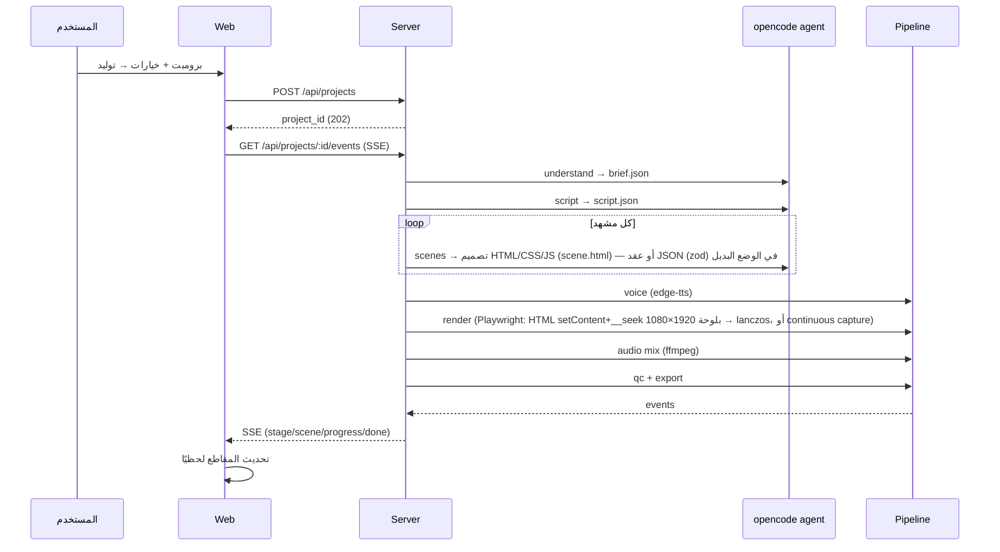

# المعمارية — Osamah vids ai

## المبادئ
- **Clean / Hexagonal**: الواجهة عرض؛ النواة نقيّة بلا I/O؛ كل I/O خلف محوّل.
- **Local-first**: كل شيء يعمل على الجهاز؛ لا سحابة.
- **كل شيء داخل المشروع**: الأدوات موطَّنة في `tools/`.
- **اللحظية عبر SSE**: لا polling.

## المخطط العام

```mermaid
flowchart TB
  subgraph Web["apps/web (React + Vite)"]
    Shell[App Shell: TopBar + Sidebar]
    Home[الرئيسية]
    New[مشروع جديد]
    Projects[المشاريع]
    Editor[المحرر CapCut-like]
    SSE[SSE client]
    Store[Zustand stores]
  end

  subgraph Desktop["apps/desktop (Electron)"]
    Main[main.ts / preload.ts / IPC]
  end

  subgraph Server["apps/server (Node)"]
    HTTP[REST API]
    EV[Event Bus → SSE]
    ORCH[Pipeline Orchestrator]
  end

  subgraph Core["packages"]
    Dom[core: domain + scene schema(zod) + timeline]
    Engine[render-engine: deterministic player]
  end

  subgraph Adapters["adapters (I/O)"]
    OC[opencode run --format json]
    TTS[edge-tts]
    PW[Playwright capture]
    FF[ffmpeg/ffprobe]
    Repo[Project repo (JSON files)]
  end

  Shell --> Home & New & Projects & Editor
  New & Editor --> HTTP
  SSE --> HTTP
  HTTP --> ORCH
  ORCH --> OC & TTS & PW & FF & Repo
  ORCH --> EV --> HTTP
  Engine -. used by .-> PW
  Dom -. types .-> Server
  Main --> Server
```

## تدفّق التوليد



## الطبقات
1. **Presentation** — `apps/web` (React): عرض فقط، لا منطق أعمال.
2. **Application** — `apps/server`: تنسيق الأنابيب، بث الأحداث، REST.
3. **Domain** — `packages/core`: الأنواع، عقد المشهد، ثوابت الخط الزمني، الثوابت (invariants).
4. **Infrastructure/Adapters** — `apps/server/src/adapters`: opencode, edge-tts, playwright, ffmpeg, fs.

## قرارات مرتبطة
انظر `docs/adr/`.
